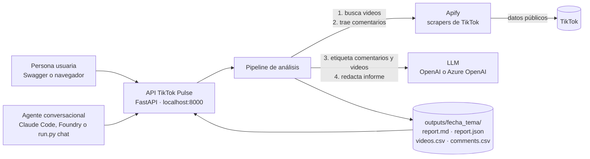
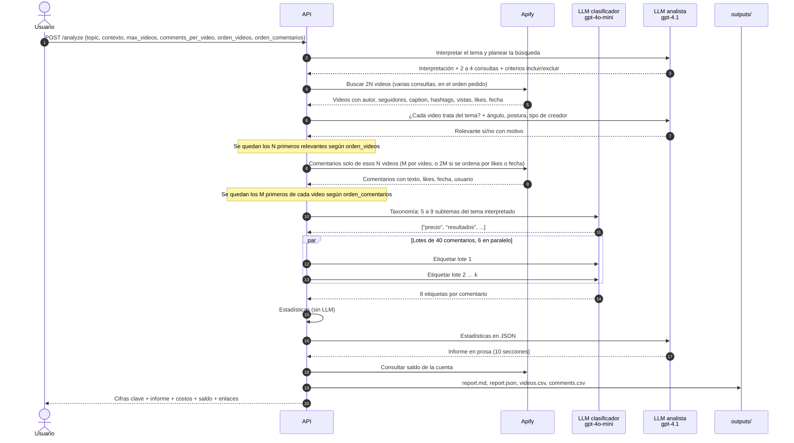
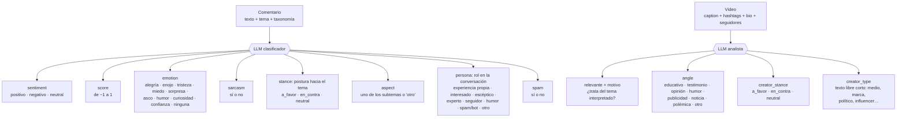
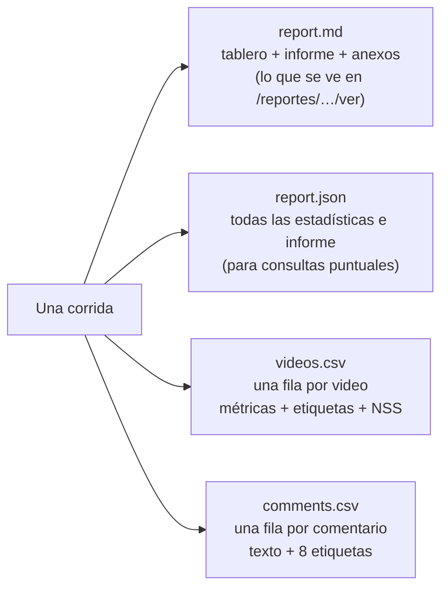
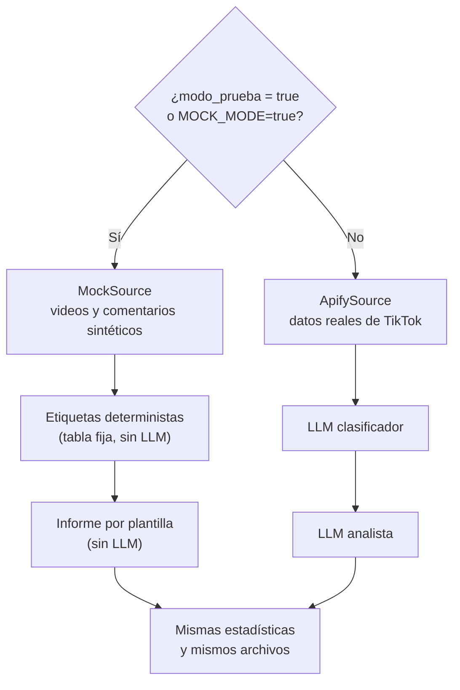
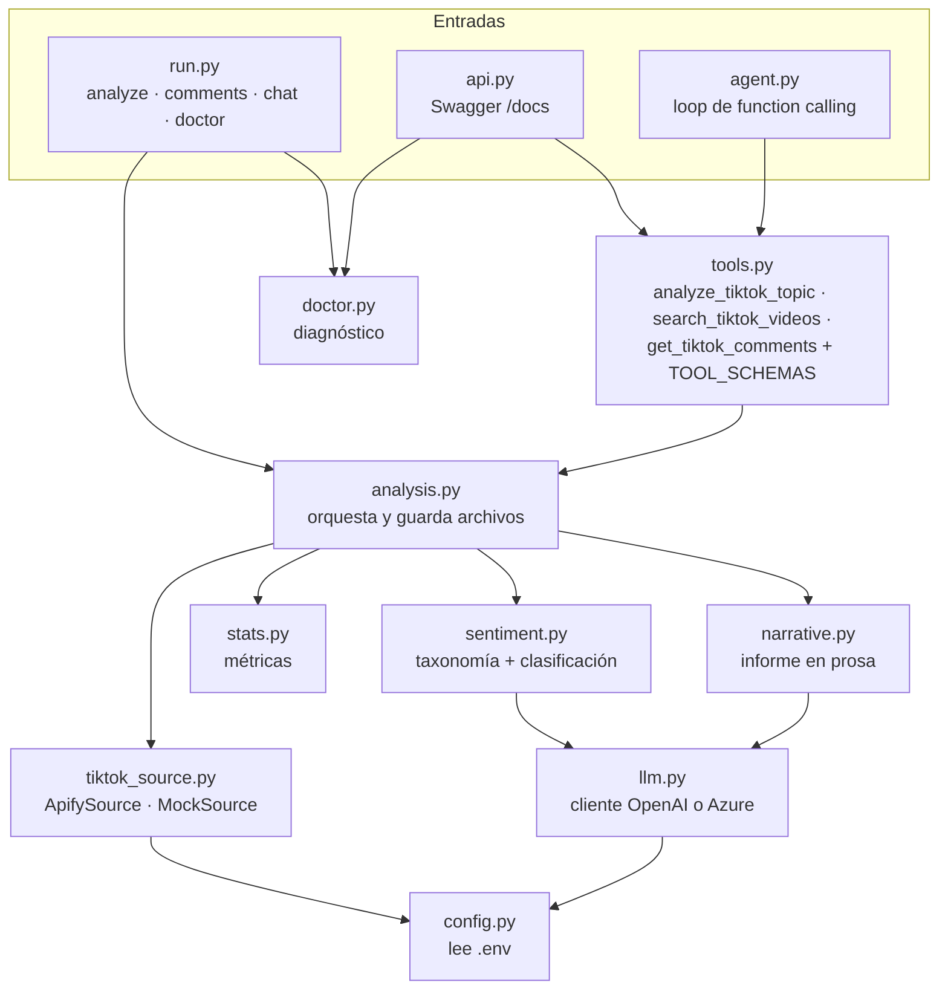
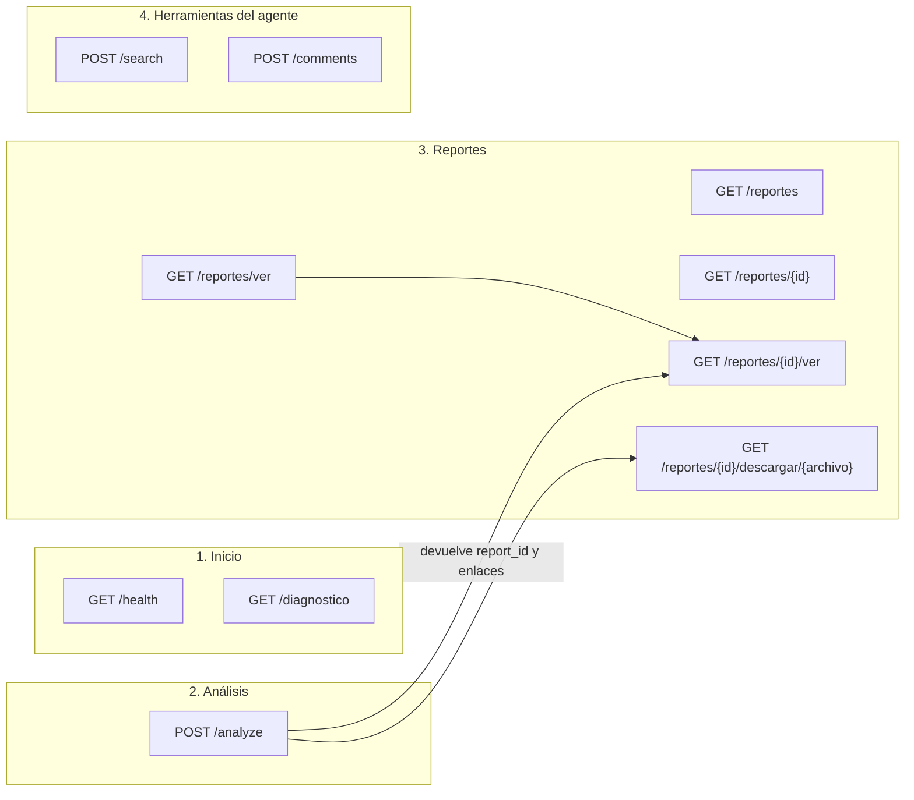
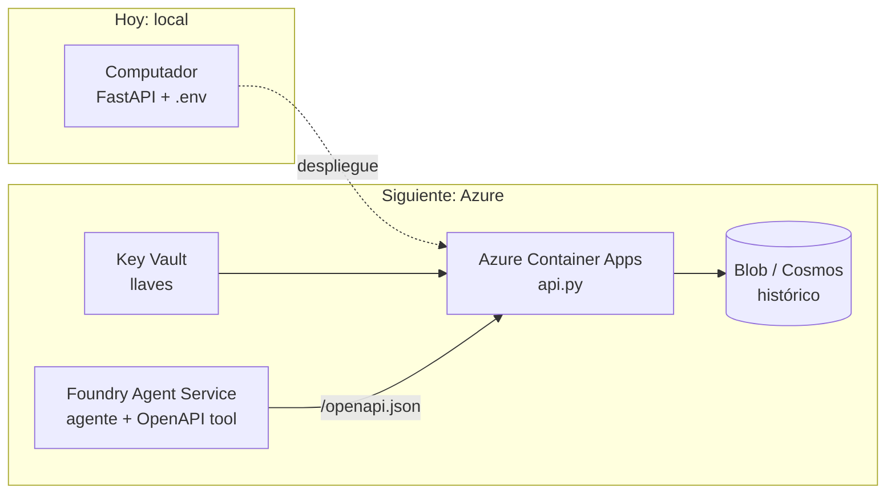

# Cómo funciona TikTok Pulse

TikTok Pulse es un agente de **social listening**. Recibe un tema (palabra clave o `#hashtag`), recoge videos públicos de TikTok y sus comentarios, usa un modelo de lenguaje (LLM) para etiquetar cada comentario y cada video, calcula estadísticas y entrega un informe escrito como lo haría un analista.

Este documento describe exactamente qué hace en cada paso, qué datos usa y qué produce. Para instalarlo y usarlo, ve a la [Guía de uso](/guia) (`docs/GUIA_DE_USO.md`).

---

## 1. Vista general

Hay dos servicios externos:

- **Apify** ejecuta "actores" que leen TikTok: `clockworks/tiktok-scraper` para buscar videos y `clockworks/tiktok-comments-scraper` para los comentarios. Cobra por resultado.
- **El LLM** se usa con dos modelos: uno barato para clasificar en volumen (`gpt-4o-mini`) y uno más capaz para redactar el informe (`gpt-4.1`).

---

## 2. El pipeline paso a paso

| Paso | Qué hace | Código |
|---|---|---|
| 1. Planear la búsqueda | El modelo analista interpreta el tema (desambigua: "inseguridad" junto a un barrio es delincuencia, no inseguridad emocional), genera 2 a 4 consultas como las escribiría alguien en TikTok y define qué incluir y qué excluir. Si el usuario da `contexto`, manda el contexto. Con `#hashtag` solo se busca el hashtag | `plan_search` en `sentiment.py` |
| 2. Buscar videos | Pide el doble de videos de los solicitados, repartidos entre las consultas. Con palabra clave, TikTok los ordena según `orden_videos`; con hashtag se ordenan aquí. Quita URLs duplicadas | `ApifySource.search_videos` en `tiktok_source.py` |
| 3. Filtrar por relevancia | El modelo analista decide, video por video, si trata del tema interpretado, y le asigna ángulo, postura y tipo de creador. Se quedan los N primeros relevantes; los descartados quedan en el reporte con su motivo. Si ninguno es relevante, se detiene antes de pagar comentarios | `classify_videos` |
| 4. Traer comentarios | Solo de los videos relevantes. Con `orden_comentarios = relevancia` se traen M por video en el orden de TikTok; con `mas_likeados` o `mas_recientes` se traen 2M y se quedan los M primeros según ese orden | `ApifySource.get_comments` |
| 5. Taxonomía | Una llamada con hasta 200 comentarios (los 120 con más likes más una muestra repartida), los captions y la interpretación del tema. Devuelve 5 a 9 subtemas concretos | `build_taxonomy` |
| 6. Etiquetar comentarios | Lotes de 40 comentarios, 6 lotes en paralelo, respuesta en JSON. Si un lote falla, sus comentarios quedan como neutrales y el análisis sigue | `classify_comments` |
| 7. Estadísticas | Cálculos deterministas en Python. Aquí no interviene el LLM | `compute_stats` en `stats.py` |
| 8. Informe | El modelo analista recibe solo las estadísticas (no los comentarios crudos) y redacta 10 secciones | `expert_report` en `narrative.py` |
| 9. Costos y saldo | Suma los tokens de cada llamada al LLM y los eventos que cobró Apify, y consulta el saldo de la cuenta | `costos.py` |
| 10. Guardar | Crea `outputs/AAAAMMDD-HHMMSS_tema/` con 4 archivos | `analyze_topic` en `analysis.py` |

---

## 3. Qué etiqueta el LLM

Reglas que sigue el clasificador:

- Solo hay tres polaridades. Si un comentario mezcla elogio y crítica, toma la que domina; si ninguna domina, es neutral.
- Si hay sarcasmo, el sentimiento es el real, no el literal ("sí claro, y yo soy astronauta 🙄" es negativo).
- Las preguntas sin postura son neutrales.
- La **persona** es el rol que se deduce del texto del comentario. **No** infiere edad, género, etnia, salud, religión ni política personal.
- Si el LLM devuelve una etiqueta fuera de la lista, se reemplaza por un valor seguro (`neutral`, `otro`).

---

## 4. Las métricas

| Métrica | Cálculo | Cómo leerla |
|---|---|---|
| **NSS** | % positivo − % negativo, sobre comentarios sin spam | −100 a 100. Por encima de 30 es claramente positivo; por debajo de −30, claramente negativo |
| **NSS ponderado por likes** | Igual, pero cada comentario pesa 1 + sus likes | Muestra qué opinión **amplifica** la audiencia |
| **IC95 de Wilson** | Intervalo de confianza del 95% para % positivo y % negativo | Si los intervalos se solapan, no se puede decir qué polo domina |
| **Polarización** | % de comentarios con score ≥ 0,6 o ≤ −0,6 | Cuánta carga emocional fuerte hay |
| **Cobertura** | Comentarios extraídos ÷ comentarios que reporta TikTok | Suele ser baja en videos virales: se leen los más visibles |
| **Engagement rate** | (likes + comentarios + compartidos + guardados) ÷ vistas, por video | Se reporta la mediana y el promedio |
| **Concentración de vistas** | % de vistas del video top y de los 3 primeros | Si es alta, el "tema" es en realidad la reacción a pocos videos |
| **HHI** | Suma de las participaciones al cuadrado de cada video en los comentarios | > 0,25 concentrada · 0,10 a 0,25 moderada · < 0,10 distribuida |
| **Tiers de creadores** | Por seguidores: nano < 10k · micro 10k–100k · mid 100k–500k · macro 500k–1M · mega > 1M | Quién publica y cuánto alcance tiene cada tamaño |
| **Recurrencia** | Comentaristas con más de un comentario y su % del volumen | Detecta a pocas personas que dominan la conversación |

Además se calculan, por aspecto y por perfil: tamaño, % del total, NSS, emoción principal y citas textuales (positivas, negativas y neutras, ordenadas por likes). También hay una serie temporal de comentarios por día con su NSS, el día pico y las preguntas más likeadas.

El **spam** se excluye de todas las métricas de opinión.

---

## 5. Qué produce

El informe en prosa siempre tiene estas secciones: resumen ejecutivo · volumen y alcance · quién publica · quién comenta · qué se está diciendo · sentimiento y emociones · evolución en el tiempo · riesgos y oportunidades · recomendaciones · notas metodológicas.

---

## 6. Modo prueba y modo real

El modo prueba recorre **todo** el pipeline sin costo y sin llaves. Sirve para verificar la instalación y para desarrollar. Sus reportes llevan `"mode": "mock"` y una franja amarilla en la vista web: **nunca** se deben presentar como hallazgos.

---

## 7. Componentes del código

Las tres "tools" de `tools.py` son las mismas en todos lados: el agente local, la API y, más adelante, Azure AI Foundry, que importa la API desde `/openapi.json`.

---

## 8. Endpoints de la API

| Endpoint | Qué hace |
|---|---|
| `GET /saldo` | Crédito disponible en Apify, cuántos análisis estándar alcanzan y si hay que recargar |
| `GET /diagnostico` | Verifica Python, paquetes, llave de Apify y ambos modelos del LLM. Nunca muestra las llaves completas |
| `POST /analyze` | Corre el pipeline completo. Con `modo_prueba: true` no cuesta nada. Por encima de 3.000 comentarios exige `confirmar_costo: true` |
| `GET /reportes` y `/reportes/ver` | Lista de corridas guardadas, en JSON o como página |
| `GET /reportes/{id}/ver` | El reporte como página web legible |
| `GET /reportes/{id}/descargar/{archivo}` | Descarga los 4 archivos de la corrida |
| `POST /search` | Solo videos, sin comentarios ni LLM |
| `POST /comments` | Comentarios y sentimiento de URLs específicas |

Si el servidor define `TOOLS_API_KEY`, las operaciones de análisis y herramientas exigen el header `x-api-key`. En uso local no hace falta.

---

## 9. Llamadas al LLM y costo por corrida

Para N comentarios:

| Llamada | Cantidad | Modelo |
|---|---|---|
| Plan de búsqueda | 1 | analista |
| Relevancia y etiquetas de videos | videos encontrados ÷ 40, redondeado hacia arriba | analista |
| Taxonomía | 1 | clasificador |
| Etiquetado de comentarios | N ÷ 40, redondeado hacia arriba | clasificador |
| Informe | 1 | analista |

Un análisis estándar (20 × 50 = 1.000 comentarios) hace unas 29 llamadas y cuesta unos centavos de dólar en LLM. El costo principal es Apify: con el plan gratuito, USD 0,0037 por video y USD 0,00125 por comentario, es decir ~USD 1,4 por análisis estándar. Cada reporte trae el costo real de la corrida en `costos` y el saldo en `saldo` (ver [Estructura del JSON](/estructura-json)).

---

## 10. Límites y privacidad

- **La muestra no es probabilística.** Depende del ranking de búsqueda de TikTok y de los comentarios más visibles. Describe la conversación visible, no "la opinión pública".
- **El LLM se puede equivocar** al clasificar (jerga, ironía) y al redactar. El informe solo recibe estadísticas, pero aun así conviene contrastar sus cifras con el tablero.
- **Comentaristas**: son personas privadas. Los reportes hablan de perfiles; `comments.csv` sí contiene el usuario de cada comentario, así que trátalo como dato personal (Ley 1581 de 2012 en Colombia) y no lo compartas fuera del equipo.
- **Creadores**: son cuentas que publican y se pueden nombrar.
- **Legal**: el scraping de datos públicos está en zona gris frente a los términos de servicio de TikTok. Para trabajo con clientes conviene una revisión legal.

---

## 11. Hacia dónde va

Otras fuentes evaluadas, en orden de prioridad: YouTube (API oficial gratuita), X/Twitter (Apify o API de pago por uso), Facebook (páginas públicas) y WhatsApp (solo exportaciones de chat con consentimiento). La arquitectura permite agregarlas implementando una nueva clase de fuente con `search_videos` y `get_comments`.
